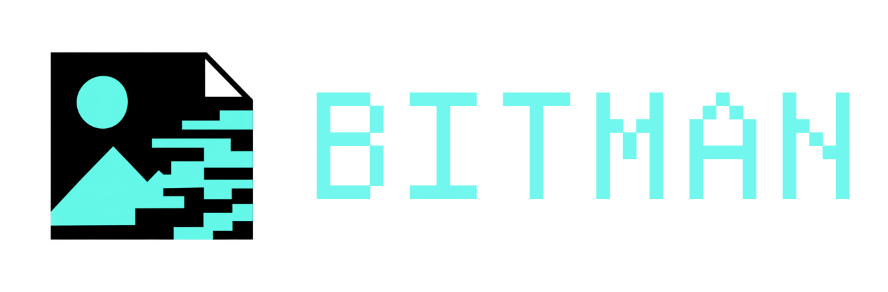

<h1 align="center">
  
</h1>

  
  
  

  
  
  

A native GPUI image and print workspace rewrite of [Boot Tool](https://github.com/sshhiiff/Boot-Tool).

All credits go to the original author [sshhiiff](https://github.com/sshhiiff) for the original application, its image-to-vector and screen-printing workflows, workspace design, interface layout, and colour palette.

## Why?

The original project does not make full use of native desktop performance.
This rewrite simply implements efficient image processing by leveraging native primitives such as SIMD and efficient memory allocations.
